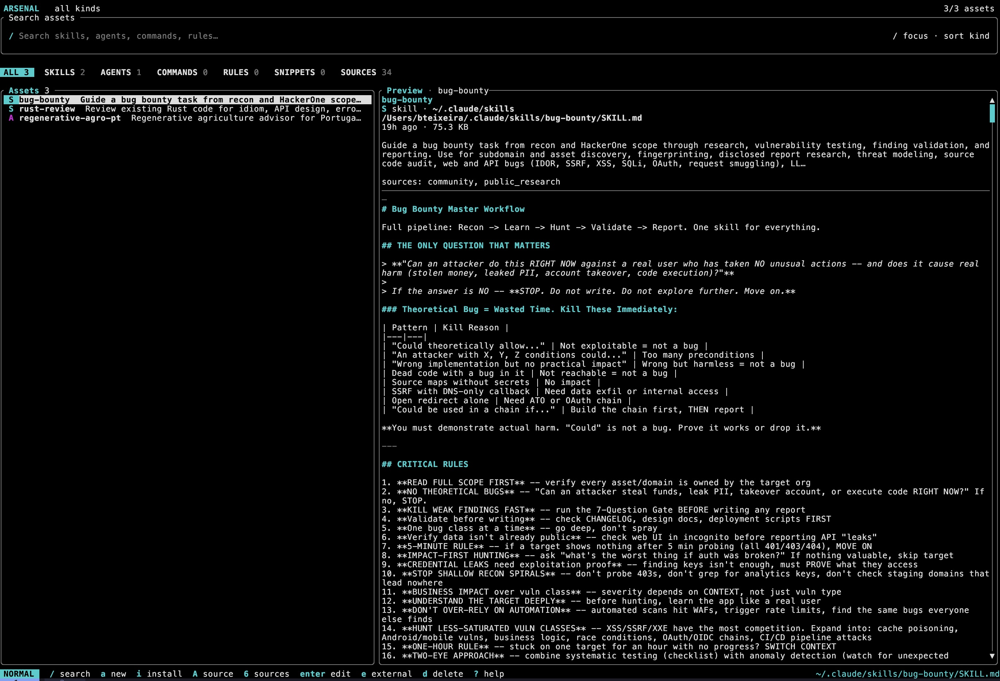

# Arsenal

A terminal UI for the Markdown assets used by coding agents: **skills**,
**agents**, **commands**, and **rules**. Browse, search, preview, create, edit,
delete, and install them from one place.

Arsenal is local-first. Assets stay as plain Markdown on disk; apart from an
explicit `arsenal install`/`arsenal remove`, it never changes files outside the
source roots you configure.



## Install

### Bun or npm

```sh
bun install -g arsenal-tui
# or
npm install -g arsenal-tui

arsenal
```

The first run downloads the matching release binary, verifies its SHA-256,
caches it, and executes it.

The launcher retries downloads and falls back to `curl` on macOS/Linux or
PowerShell/`curl.exe` on Windows when `fetch` cannot reach GitHub. For a proxy,
set `HTTPS_PROXY`/`HTTP_PROXY`, point `ARSENAL_RELEASE_BASE_URL` at a mirror, or
set `ARSENAL_BINARY` to a local build.

Supported targets:

- macOS arm64 and x64
- Linux arm64 and x64 (glibc)
- Windows x64 — static MSVC runtime, no Visual C++ Redistributable required

### From source

Requires Rust 1.88+.

```sh
cargo install --path . --root "$HOME/.local"
arsenal
```

For development:

```sh
cargo run -- --help
```

## Quick start

```sh
arsenal                                  # use the configured sources
arsenal --root skill=./skills --root agent=./agents
arsenal --query deploy                   # start with a search filter
arsenal list --json | jq                 # scriptable, no TUI

arsenal install https://github.com/anthropics/skills/tree/main/skills/pdf
arsenal remove pdf                       # move an asset to the trash
arsenal mcp                              # expose assets to an agent over MCP
arsenal uninstall                        # remove Arsenal itself
```

On first launch Arsenal writes a commented configuration to
`~/.config/arsenal/config.toml` and scans the conventional source roots.

## Integrations

Arsenal discovers the documented user and project roots for the major agent
tools. Existing sources are labeled by integration in the Sources tab and the
install/create forms.

| Integration | User root | Project root | Kinds |
| --- | --- | --- | --- |
| OMP | `~/.omp/agent` | `./.omp` | skills, agents, commands, rules |
| Claude Code | `~/.claude` | `./.claude` | skills, agents, commands, rules |
| OpenCode | `~/.config/opencode` | `./.opencode` | skills, agents, commands |
| Codex | `~/.codex` | `./.codex` | skills |
| Gemini CLI | `~/.gemini` | `./.gemini` | skills |
| Agents | `~/.agents`, `~/.agent` | `./.agents`, `./.agent` | skills, agents, commands, rules |
| GitHub | — | `./.github` | skills |

Each root uses the tool's normal `<kind>s/` layout, for example
`~/.config/opencode/skills/<name>/SKILL.md`.

When more than one destination exists, the create and install forms start at
`choose integration`; select the target with `←`/`→` before submitting. With one
destination it is preselected.

`arsenal integrations` prints every supported integration root and whether it
exists; `--json` is available for scripting.

### OMP discovery

OMP reads its native roots directly. It only reads foreign `~/.claude` user
skills when `~/.omp/agent/config.yml` opts in:

```yaml
enabledProviders:
  - claude
```

Project-local `.claude` sources do not require this opt-in. Installs performed
without an explicit choice default to OMP's native root in the CLI; the TUI
requires a destination when several sources exist.

## Asset conventions

| Kind | Layout | Frontmatter |
| --- | --- | --- |
| `skill` | `<root>/<name>/SKILL.md` | `name`, `description`, `tags` |
| `agent` | `<root>/<name>.md` | `name`, `description`, `tools` |
| `command` | `<root>/<name>.md` | `description` |
| `rule` | `<root>/<name>.md` | `description`, `globs` |
| `snippet` | `<root>/<name>.md` | `name`, `description` |

- Skills are directories containing `SKILL.md`; flat `*.md` files directly in a
  skill root are also accepted.
- Other kinds are `*.md` files scanned recursively up to the configured
  `behavior.scan_depth`.
- Frontmatter is YAML between `---` lines. If parsing fails, a lenient
  `key: value` parser keeps the file usable. `tags`/`keywords` accepts a comma
  list, an inline list, or a block list.
- Displayed name: frontmatter `name`, then the directory name/file stem.
- Displayed description: frontmatter `description`, then the first prose line.

## Keymaps

Vim-style sequences are supported (`g g` is a sequence, not two independent
keys). Every binding is remappable.

| Key | Action |
| --- | --- |
| `j` / `k` / `↓` / `↑` | Move down / up |
| `g g` / `G` / `home` / `end` | Top / bottom |
| `ctrl-d` / `ctrl-u` | Half page down / up |
| `ctrl-f` / `ctrl-b` / `pgdn` / `pgup` | Page down / up |
| `J` / `K` | Scroll preview |
| `/` | Focus search |
| `ctrl-h` | Focus search |
| `ctrl-l` | Focus preview |
| `n` / `N` | Next / previous match |
| `0`–`5` | All kinds, skills, agents, commands, rules, snippets |
| `6` | Sources tab |
| `s` | Cycle sort |
| `F` | Toggle content search |
| `t` | Toggle preview |
| `T` | Cycle theme |
| `a` | Create an asset |
| `i` | Install from git |
| `A` | Add a source folder |
| `enter` | Edit in the built-in editor |
| `e` | Edit in `$EDITOR` |
| `d` | Delete (confirmation, moves to trash) |
| `y` | Copy path with OSC 52 |
| `o` | Reveal in file manager |
| `R` | Rescan sources |
| `g c` | Edit the configuration |
| `g k` | Edit key bindings |
| `:` | Command palette |
| `?` | Help |
| `q` | Quit |

`ctrl-c` quits outside the inline editor; inside the editor it is copy. `esc`
clears the pending sequence or active search.

On macOS Terminal, `ctrl-h` arrives as Backspace; Arsenal treats Backspace in
Normal mode as focus-search. `ctrl-left` and `ctrl-right` also focus the search
and preview panes.

The preview can be focused with `ctrl-l`; `j`/`k`, arrows, `g g`/`G`, page keys,
and `ctrl-d`/`ctrl-u` then scroll the preview instead of moving the selection.

## Search

The search bar sits below the header. Press `/` (or `ctrl-h`) to focus it; the
list and counts update live. `enter` keeps the query, `esc` restores the previous
query, and `ctrl-l` moves to the preview with the query preserved.

Terms are ANDed and fuzzy-matched against name, kind, tags, and description. A
term prefixed with `#` filters tags:

```text
/railway
/#ops deploy
```

Press `F` or use `:content on` to search document bodies too. Matching preview
lines are underlined.

## Installing assets

Press `i` or run:

```sh
arsenal install <URL|owner/repo> [--kind KIND] [--dest PATH]
                [--name NAME] [--ref REF] [--subdir PATH] [--force]
```

GitHub `tree/<ref>/<path>` and `blob/<ref>/<path>` URLs work, as do `owner/repo`
and git/ssh/file URLs.

- The repository is shallow-cloned into a temporary directory; only the selected
  asset is copied.
- Skills are copied as whole directories, including scripts and references.
- Agents, commands, rules, and snippets install a single Markdown file.
- The TUI shows clone/copy progress and closes automatically on success.
- `--force` replaces an existing destination by moving the old copy to trash.

## Creating assets

Press `a` or use `:new agent`:

```text
╭ New skill ─────────────────────────────────────────────╮
│ kind        skill                                      │
│ name        incident-runbook                           │
│ description Step-by-step incident response for on-call │
│ source      choose integration                         │
│ enter creates the file; tab cycles fields              │
╰────────────────────────────────────────────────────────╯
```

`tab`/`shift-tab` move between fields, `←`/`→` change kind and destination, and
`enter` writes the scaffold and selects it. Existing files are never
overwritten.

## Removing assets and Arsenal

Remove one managed asset:

```sh
arsenal remove                 # choose from the installed asset list
arsenal remove <name|path>
arsenal remove <name|path> --kind skill
arsenal remove <name|path> --purge
```

By default assets move to `~/.local/share/arsenal/trash`. `--purge` deletes
permanently. Skills are removed as whole directories.

Remove Arsenal itself:

```sh
arsenal uninstall
```

This removes the running binary, the launcher cache, and the global
`arsenal-tui` package when launched through npm/Bun. Configuration and managed
assets are preserved.

## Editing

`enter` opens the selected Markdown file in a full-pane editor with line
numbers. `ctrl-s` saves atomically; dirty buffers ask before discard. `ctrl-z` /
`ctrl-r` undo and redo. `e` still opens the document in `$EDITOR`.

## Sources

Press `6` for the Sources tab. It shows every configured root with its
integration label, kind, existence, and asset count. `/` filters sources; `y`
copies the path; `o` opens it.

Add a source from the TUI with `A`, or from the shell:

```sh
arsenal sources add ~/extra-skills
arsenal sources add ~/work/agent-assets --kind agent
arsenal sources list [--json]
arsenal sources remove ~/extra-skills
```

Sources added this way are stored in `config.sources.toml` next to the main
config; `config.toml` is not rewritten.

## CLI

```text
arsenal [--config PATH] [--root KIND=PATH]... [--query QUERY]
arsenal list [--json] [--kind KIND] [--sort MODE] [--content]
arsenal install <URL|owner/repo> [--kind KIND] [--dest PATH] [--name NAME]
                [--ref REF] [--subdir PATH] [--force]
arsenal remove [NAME|PATH] [--kind KIND] [--purge]
arsenal mcp
arsenal mcp health [--json]
arsenal uninstall
arsenal sources list [--json]
arsenal sources add <PATH> [--kind KIND]
arsenal sources remove <PATH> [--kind KIND]
arsenal integrations [--json]
arsenal config path
arsenal config init [--force]
arsenal config validate
```

`list` prints `kind name path`; `--json` emits one object per asset with `kind`,
`name`, `description`, `tags`, `path`, `source`, and `modified` (Unix seconds).

## MCP server

`arsenal mcp` runs a [Model Context Protocol](https://modelcontextprotocol.io)
server over stdio, so an agent can inspect and change the same assets the TUI
manages. It uses the same configuration, `--root` overrides, and source roots;
stdout carries JSON-RPC only and warnings go to stderr.

Register it with any stdio MCP client. For Claude Code:

```sh
claude mcp add arsenal -- arsenal mcp
```

For Claude Desktop or another `mcpServers` config:

```json
{
  "mcpServers": {
    "arsenal": {
      "command": "arsenal",
      "args": ["mcp"]
    }
  }
}
```

Add global flags before the subcommand to pin roots:

```json
{
  "mcpServers": {
    "arsenal": {
      "command": "arsenal",
      "args": ["--root", "skill=/absolute/path/to/skills", "mcp"]
    }
  }
}
```

Tools:

| Tool | Purpose |
| --- | --- |
| `list_assets` | Filter by kind, fuzzy query, `#tag`, or body content |
| `read_asset` | Read Markdown, metadata, and a skill's file list |
| `create_asset` | Scaffold or write a new asset in a configured root |
| `write_asset` | Replace an existing asset's full Markdown document |
| `delete_asset` | Move an asset to the trash, or `purge` it |
| `install_asset` | Clone a GitHub/git asset into a configured root |
| `list_sources` | Show configured roots, kinds, and existence |
| `server_health` | Version, protocol, source status, asset counts, warnings |

Health checks:

- MCP `ping` returns an empty result while the server is accepting requests.
- `arsenal mcp health` runs a one-shot preflight without starting the server.
  It reports `ok`, `degraded` (scan warnings), or `unhealthy` (no source
  directories exist), and exits non-zero only when unhealthy. Add `--json` for
  monitoring.
- The `server_health` tool returns the same report to an agent.

Assets are also exposed as `file://` resources via `resources/list` and
`resources/read`. Writes are restricted to assets found in configured source
roots; creation and installation only target configured roots. Deletes honor
`behavior.trash` and move to `~/.local/share/arsenal/trash` by default.

## Configuration

Resolution order:

1. `--config PATH`
2. `$ARSENAL_CONFIG`
3. `$XDG_CONFIG_HOME/arsenal/config.toml`
4. `~/.config/arsenal/config.toml`

The file is created on first use. `arsenal config init --force` rewrites it.

```toml
[editor]
command = ""                 # empty: $VISUAL, $EDITOR, then vi
args = ["+{line}", "{file}"]

[layout]
list_width = 38
show_preview = true

[search]
content = false              # search bodies by default

[behavior]
scan_depth = 4
confirm_delete = true
trash = true                 # move deletes to the trash directory

[theme]
preset = "dark"              # dark | light | mono
# accent = "cyan"
# border = "darkgray"
# muted = "gray"
# success = "green"
# warning = "yellow"
# error = "red"
# skill = "cyan"
# agent = "magenta"
# command = "green"
# rule = "yellow"
# snippet = "blue"

[keys]
# "quit" = "q"
# "search" = "/"
# "focus_preview" = "ctrl-l"
```

Keys changed in the `g k` editor are stored in `config.keys.toml`. Sources added
with `A` or `arsenal sources add` are stored in `config.sources.toml`.

## Development

```sh
cargo fmt --check
cargo clippy --all-targets -- -D warnings
cargo test
cargo run
```

The repository has two CI workflows:

- `ci.yml` — format, clippy, tests, release build, and packaging checks.
- `release-bun.yml` — tag-triggered binary build, GitHub release, and Bun/npm
  publish.

## License

MIT. See [LICENSE](LICENSE).
